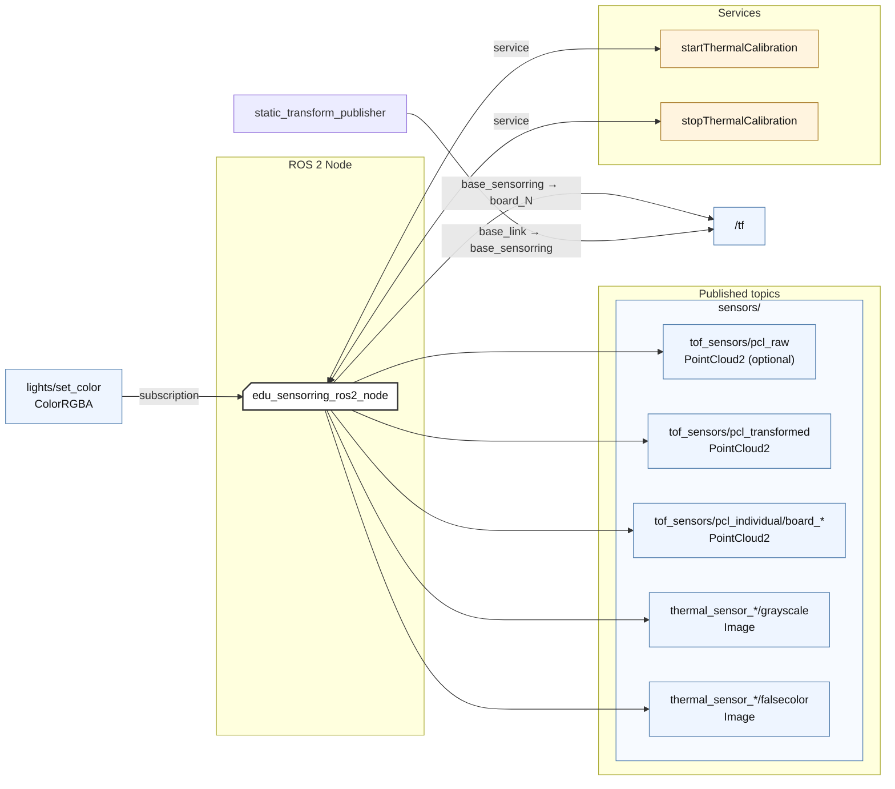

# EduArt Sensorring ROS 2 Wrapper
The software interface of the EduArt Sensorring is the lightweight and framework independent [edu_lib_sensorring](https://github.com/EduArt-Robotik/edu_lib_sensorring) library.
This repository is a wrapper of the library to use the Sensorring measurements in ROS 2.

>Note: For a Ros1 wrapper see the [edu_sensorring_ros1](https://github.com/EduArt-Robotik/edu_sensorring_ros1) repository.

The library supports the Linux-specific SocketCAN backend and the USBtingo USB adapter backend.
The ROS 2 launch and container examples in this repository target Linux.

# Building and running the node

The node can be run either locally on systems with a ROS 2 environment or in a docker container that is also included in this repository.

## Running the node locally

To run the node locally you need to have ROS 2 installed.
Refer to the official [ROS 2 installation guide](https://docs.ros.org/en/jazzy/Installation.html).

### 1. Clone the Sensorring node into your ROS 2 workspace
```
mkdir -p ~/ros2_ws/src
cd ~/ros2_ws/src
git clone -b master https://github.com/EduArt-Robotik/edu_sensorring_ros2.git
```

### 2. Build the node
To build this node, the underlying `edu_lib_sensorring` library does not have to be installed manually.
Depending on the application, a local copy may be used for development.
The `edu_sensorring_ros2` wrapper resolves the `edu_lib_sensorring` dependency in this order:

1. A local source checkout at `edu_sensorring_ros2/external/edu_lib_sensorring`.
2. An installed package that satisfies the `4.0.0` CMake package version request.
3. Otherwise, CMake automatically downloads and builds tag `v4.0.0`.

For the usual setup, no separate library installation is needed.
Internet access is required during the first configure/build when neither a local checkout nor a compatible installed package is available.

The package uses the standard ROS 2 `colcon build` toolchain:
```
cd ~/ros2_ws
colcon build --packages-select edu_sensorring_ros2 --symlink-install
source ~/ros2_ws/install/setup.bash
```

### 3. Start the node
For automatic hardware discovery, use the included launch file.
It reads `params/auto_discover_params.yaml` and publishes the static transform from `base_link` to `base_sensorring`.
```
cd ~/ros2_ws
source install/setup.bash
ros2 launch edu_sensorring_ros2 auto_discover.launch.py
```

> The launch files in this package use the `EDU_ROBOT_NAMESPACE` environment variable, which defaults to an empty namespace.
> If you want to launch this node using a namespace set the environemnt variable to your desired namespace value.

# Configuration Modes

The node supports three configuration modes that control how hardware discovery and topology validation are handled.
The mode is selected via two parameters in `base_setup`:

| `auto_discover` | `enforce_topology` | Mode | Description |
|---|---|---|---|
| `true` | *(ignored)* | **Auto-Discover** | The factory discovers all connected hardware on the configured interfaces without requiring sensor board declarations; sensor poses default to identity (zero rotation/translation), making this mode suitable for quick testing or setups where transforms are not needed. |
| `false` | `false` | **Relaxed** | Sensor boards are declared with their poses in the parameter file; the factory matches declared boards to physical hardware but **ignores** extra connected boards not listed in the configuration; this is the **default** mode. |
| `false` | `true` | **Strict** | Sensor boards are declared with their poses in the parameter file, and every declared board **must** match a physical board exactly; the node fails to start if any declared board is missing or unexpected boards are found; use this mode for applications where the topology must be guaranteed. |

## Auto-Discover Mode

The simplest configuration only requires specifying the communication interface(s).
The node will discover all connected sensor boards and start publishing measurements immediately.
Sensor poses are identity (all points in their local sensor frame).

```yaml
pointcloud_sensor:
  base_setup:
    auto_discover: true
  topology:
    nr_of_interfaces: 1
    interfaces:
      interface_0:
        interface_type: "socketcan"
        interface_name: "can0"
```

Use the included launch file for auto-discovery:
```
cd ~/ros2_ws
source install/setup.bash
ros2 launch edu_sensorring_ros2 auto_discover.launch.py
```

## Relaxed Mode (Default)

Declare the boards you care about with their poses.
Any additional connected boards will be silently ignored.
This is useful when you only want to process a subset of the connected sensors.

```yaml
pointcloud_sensor:
  base_setup:
    auto_discover: false
    enforce_topology: false
  topology:
    nr_of_interfaces: 1
    interfaces:
      interface_0:
        interface_type: "socketcan"
        interface_name: "can0"
        nr_of_boards: 3
        boards:
          board_0:
            board_type: "headlight"
            expected_devices: ["any_depth", "htpa32", "any_light"]
            orientation: "left"
            rotation: [90.0, 0.0, 45.0]
            translation: [0.1, 0.0, 0.05]
          # ... more boards
```

If `board_type` is omitted or left empty, the factory will match any compatible board.
If `expected_devices` is an empty array, all discovered devices on the matched board are instantiated.

## Parameter Reference

The node reads all parameters below the `pointcloud_sensor` namespace.

### Base setup and publishers

| Parameter | Type | Default | Description |
|---|---|---|---|
| `base_setup.timeout_ms` | integer | `1000` | Measurement manager timeout in milliseconds. |
| `base_setup.repair_errors` | bool | `true` | Enables automatic recovery attempts inside the measurement manager. |
| `base_setup.tf_name` | string | `"base_sensorring"` | Root frame used for published transforms and transformed point clouds. |
| `base_setup.enforce_topology` | bool | `false` | Enables strict topology validation when `auto_discover` is `false`. |
| `base_setup.auto_discover` | bool | `false` | If `true`, no boards are configured explicitly and all detected hardware is used. |
| `publishers.depth_individual` | bool | `true` | Publish one point cloud topic per detected depth sensor. |
| `publishers.depth_combined` | bool | `true` | Publish one transformed point cloud with all depth sensors combined. |
| `publishers.depth_raw` | bool | `true` | Publish one untransformed point cloud with all depth sensors combined. |

### Device Defaults

These parameters define default configuration values that are applied whenever a matching device is instantiated by the factory.

| Parameter | Type | Default | Description |
|---|---|---|---|
| `htpa32_config.enable` | bool | `true` | Enable HTPA32 thermal sensors when they are instantiated. |
| `htpa32_config.auto_min_max` | bool | `true` | Automatically derive grayscale / false-color temperature limits from the image. |
| `htpa32_config.use_eeprom_file` | bool | `false` | Load thermal EEPROM data from files instead of reading it from hardware at startup. |
| `htpa32_config.use_calibration_file` | bool | `false` | Load saved thermal calibration data from files. |
| `htpa32_config.eeprom_file_dir` | string | `""` | Directory containing stored EEPROM dumps for thermal sensors. |
| `htpa32_config.calibration_file_dir` | string | `""` | Directory containing saved thermal calibration files. |
| `htpa32_config.scale_t_min_deg` | double | `20.0` | Lower bound in degree Celsius for thermal image scaling when auto scaling is disabled. |
| `htpa32_config.scale_t_max_deg` | double | `30.0` | Upper bound in degree Celsius for thermal image scaling when auto scaling is disabled. |
| `htpa32_config.max_rate_hz` | double | `5.0` | Maximum measurement rate for HTPA32 thermal sensors. |
| `vl53l8cx_config.enable` | bool | `true` | Enable VL53L8CX depth sensors when they are instantiated. |
| `vl53l8cx_config.max_rate_hz` | double | `15.0` | Maximum measurement rate for VL53L8CX depth sensors. |
| `tmf8829_config.enable` | bool | `true` | Enable TMF8829 depth sensors when they are instantiated. |
| `tmf8829_config.resolution_mode` | integer | `0` | TMF8829 resolution preset: `0=8x8`, `1=8x8LR`, `2=8x8HA`, `3=16x16`, `4=16x16HA`, `5=32x32`, `6=32x32HA`, `7=48x32`, `8=48x32HA`. |
| `tmf8829_config.k_iterations` | integer | `0` | TMF8829 integration setting in kilo-iterations per measurement; `0` uses the sensor default. |
| `tmf8829_config.max_rate_hz` | double | `30.0` | Maximum measurement rate for TMF8829 depth sensors. |
| `led_config.initial_mode` | integer | `0` | Initial light mode applied to all detected light devices when the node starts; valid values are `0..11` (`0=Off`, `1=Dimmed`, `2=HighBeam`, `3=FlashAll`, `4=FlashLeft`, `5=FlashRight`, `6=Pulsation`, `7=Rotation`, `8=Running`, `9=MapDistance`, `10=FixedColor`, `11=PulsationColor`). |
| `led_config.initial_color` | integer array `[r,g,b]` | `[0, 0, 0]` | Initial RGB color applied together with `initial_mode`; each value must be in `[0, 255]`. |
| `led_config.distance_map_lower_m` | double | `0.1` | Distance in meters at or below which MapDistance LEDs are red. |
| `led_config.distance_map_upper_m` | double | `0.5` | Distance in meters at or above which MapDistance LEDs are green. |
| `led_config.distance_map_max_brightness` | integer | `50` | Peak MapDistance LED channel brightness on the `0..255` scale. `0` disables the indicator. |

### topology

| Parameter | Type | Default | Description |
|---|---|---|---|
| `topology.nr_of_interfaces` | integer | `1` | Number of communication interfaces to configure. |
| `topology.interfaces.interface_N.interface_type` | string | `"undefined"` | Interface backend; supported values are `socketcan` and `usbtingo`. |
| `topology.interfaces.interface_N.interface_name` | string | `""` | OS-visible interface name, for example `can0` or a USB adapter name. |
| `topology.interfaces.interface_N.enable_brs` | bool | `false` | Enables CAN-FD bitrate switching for messages sent from sensor boards to the host. |
| `topology.interfaces.interface_N.data_baudrate` | integer | `0` | Optional CAN-FD data bitrate in bits per second; relevant when BRS is enabled. |
| `topology.interfaces.interface_N.sample_point` | double | `0.0` | Optional CAN-FD data sample point in the range `[0, 1]`. |
| `topology.interfaces.interface_N.nr_of_boards` | integer | `1` | Number of expected boards on this interface when `auto_discover` is `false`. |

Each configured board is declared below `topology.interfaces.interface_N.boards.board_M`.

| Board Parameter | Type | Default | Description |
|---|---|---|---|
| `board_type` | string | `"Undefined"` | Optional hardware board type constraint; supported values are `headlight`, `taillight`, `sidepanel`, and `minipanel`; if `Undefined` or empty, any compatible board may match. |
| `expected_devices` | string array | `[]` | Optional expected devices for that board; if empty, all discovered devices on the matched board are instantiated. |
| `orientation` | string | `"none"` | Board orientation used by devices that need left/right aware processing; supported values are `none`, `left`, and `right`. |
| `rotation` | double array `[roll,pitch,yaw]` | `[0.0, 0.0, 0.0]` | Board rotation in degrees, applied in roll-pitch-yaw order. |
| `translation` | double array `[x,y,z]` | `[0.0, 0.0, 0.0]` | Board translation in meters. |

Supported `expected_devices` entries:

| Value | Meaning |
|---|---|
| `vl53l8cx` | Require a VL53L8CX depth sensor. |
| `tmf8829` | Require a TMF8829 depth sensor. |
| `htpa32` | Require an HTPA32 thermal sensor. |
| `ws2812b` | Require a WS2812b light device. |
| `any_depth` | Accept any supported depth sensor on that board. |
| `any_thermal` | Accept any supported thermal sensor on that board. |
| `any_light` | Accept any supported light device on that board. |

The aliases `tof`, `depth`, `thermal`, `light`, and `led` are also accepted by the node parser.

## Strict Mode

Strict mode is the same as relaxed mode, but the factory validates that the declared topology exactly matches the physical hardware.
Use it in production to catch wiring or hardware issues.

```yaml
pointcloud_sensor:
  base_setup:
    auto_discover: false
    enforce_topology: true
```


## Running the node in a container

The repository includes separate generic and demonstrator Docker Compose setups.
They install the ROS and Sensor Ring dependencies in a container, so these do not need to be installed on the host.
The Compose services are configured to restart automatically.

To use the container you need to install Docker.
Refer to the official [Docker installation guide](https://docs.docker.com/engine/install/).

### Generic container

This setup runs the generic node configuration from `docker/generic/launch_content/sensorring_params.yaml`.

1. Clone the repository:
```
mkdir -p ~/eduart_ws
cd ~/eduart_ws
git clone -b master https://github.com/EduArt-Robotik/edu_sensorring_ros2.git
```

2. Build and start the container from the directory containing its Compose file:
```
cd ~/eduart_ws/edu_sensorring_ros2/docker/generic
docker compose build
docker compose up -d
```

The container uses `docker/generic/launch_content/sensorring.launch.py`.
The Compose file forwards `EDU_ROBOT_NAMESPACE`, `RMW_IMPLEMENTATION`, and `ROS_DOMAIN_ID` from the host.
Set `EDU_ROBOT_NAMESPACE` explicitly if you want to use a namespace.
The launch file's `eduard` fallback applies only if the variable is absent in the container.
Its restart policy is `always`.

### Demonstrator container

The demonstrator setup additionally starts RViz.
It uses the configuration in `docker/demonstrator/launch_content/demonstrator_params.yaml`.
```
cd ~/eduart_ws/edu_sensorring_ros2/docker/demonstrator
docker compose build
docker compose up -d
```

This setup requires a working graphical display.
It uses `DISPLAY`, `XDG_RUNTIME_DIR`, `RMW_IMPLEMENTATION`, `ROS_DOMAIN_ID`, and `EDU_ROBOT_NAMESPACE` from the host environment.
Both Compose setups can be checked with `docker compose ps` and stopped from their respective directories with `docker compose down`.

To follow the container logs:
```
docker compose logs -f
```

# ROS 2 interface of the node

## 1. Overview
The diagram below shows the current ROS 2 interface of the node.
The node publishes one point cloud per depth sensor and up to two combined point clouds: raw points and points transformed into the common `base_sensorring` frame.
Publisher topics depend on the detected/configured sensors and the `pointcloud_sensor.publishers` parameters.
The node also publishes static transforms from `base_sensorring` to each detected depth sensor's `board_N` frame.



## 2. Publisher


### /sensors/tof_sensors/pcl_raw
There is one publisher that publishes the point cloud data from all Time-of-Flight sensors of the Sensorring.
The message type is a [`sensor_msgs/msg/PointCloud2`](https://docs.ros.org/en/jazzy/p/sensor_msgs/msg/PointCloud2.html).
The combined measurements are **not** transformed into a common coordinate system.
The points from the individual sensors can be distinguished by the PointField `sensor_idx` in the point cloud message.

### /sensors/tof_sensors/pcl_transformed
There is one publisher that publishes the point cloud data from all Time-of-Flight sensors of the Sensorring.
The message type is a [`sensor_msgs/msg/PointCloud2`](https://docs.ros.org/en/jazzy/p/sensor_msgs/msg/PointCloud2.html).
The combined measurements are transformed into a common coordinate system.
The points from the individual sensors can be distinguished by the PointField `sensor_idx` in the point cloud message.
### /sensors/tof_sensors/pcl_individual/board_*
There is one publisher per detected depth sensor, on a topic named `board_*`, that publishes its point cloud in the board's local frame.
The message type is [`sensor_msgs/msg/PointCloud2`](https://docs.ros.org/en/jazzy/p/sensor_msgs/msg/PointCloud2.html).
These individual point clouds can be used as input for a voxel layer for autonomous navigation.

### /sensors/thermal_sensor_*/falsecolor
There is one publisher for each sensor that publishes a falsecolor image of the thermal measurement.
The message type is [`sensor_msgs/msg/Image`](https://docs.ros.org/en/jazzy/p/sensor_msgs/msg/Image.html).

### /sensors/thermal_sensor_*/grayscale
There is one publisher for each thermal sensor that publishes a grayscale image of the thermal measurement.
The message type is [`sensor_msgs/msg/Image`](https://docs.ros.org/en/jazzy/p/sensor_msgs/msg/Image.html).

## 3. Subscriber

### /lights/set_color
Subscribes to [`std_msgs/msg/ColorRGBA`](https://docs.ros.org/en/jazzy/p/std_msgs/msg/ColorRGBA.html) and sets all connected light devices to the received RGB color using the `FixedColor` mode.
The `r`, `g`, and `b` values are clamped to `[0.0, 1.0]`; `a` is ignored.

## 4. Services

### `/<namespace>/<node-name>/startThermalCalibration`
The `edu_sensorring_ros2/srv/StartThermalCalibration` service starts calibration on the thermal sensors.
The `window` request field sets the number of thermal frames to average; the `output` response field reports success or failure.

```
ros2 service call /edu_sensorring_ros2_node/startThermalCalibration edu_sensorring_ros2/srv/StartThermalCalibration "{window: 20}"
```

**Thermal calibration:**

1. Run the Sensorring node for 10 to 20 minutes so that all sensors reach a steady operating temperature.
2. Place an object in front of the thermal sensors that covers the whole sensor area and has a uniform surface and temperature, e.g. a cardboard box.
   Do not touch the side of your calibration target facing the sensor directly before calibration.
3. Call the thermal calibration service.
   The window size defines how many thermal frames are averaged for the calibration; 20 to 100 frames are recommended.
4. Wait for the calibration to finish.
   If `use_calibration_file` is `true`, the calibration values are automatically stored in a file and loaded each time the node starts.

### `/<namespace>/<node-name>/stopThermalCalibration`
The `edu_sensorring_ros2/srv/StopThermalCalibration` service stops calibration when the request's `stop` field is `true`.
The `output` response field reports success or failure.
```
ros2 service call /edu_sensorring_ros2_node/stopThermalCalibration edu_sensorring_ros2/srv/StopThermalCalibration "{stop: true}"
```

When `EDU_ROBOT_NAMESPACE` is set (for example to `eduard`), include that namespace in the service name.
For example, use `/eduard/edu_sensorring_ros2_node/startThermalCalibration`.
